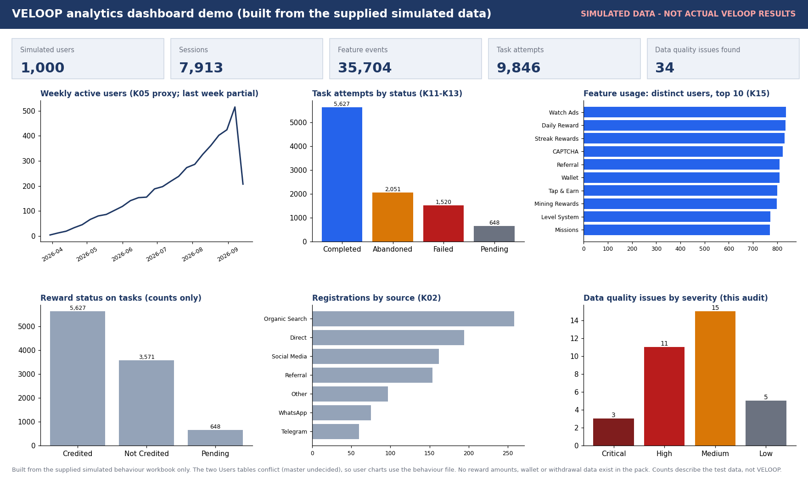
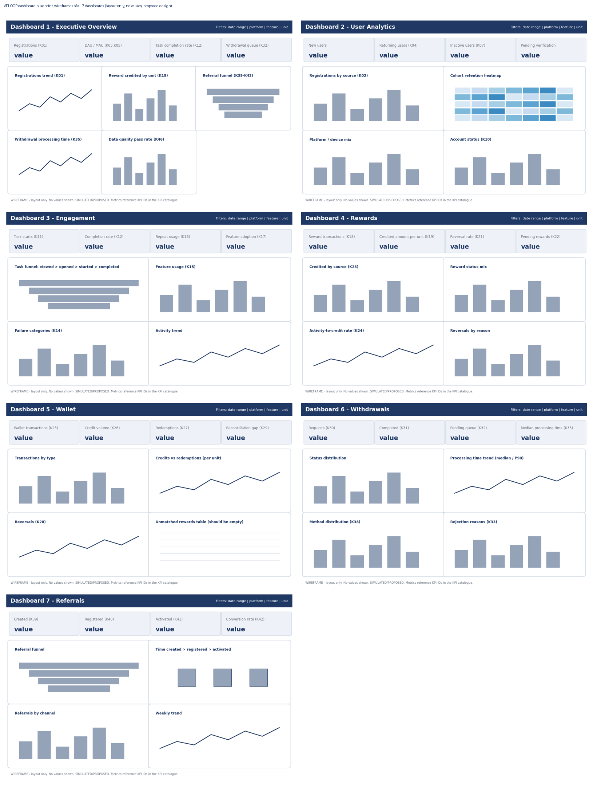
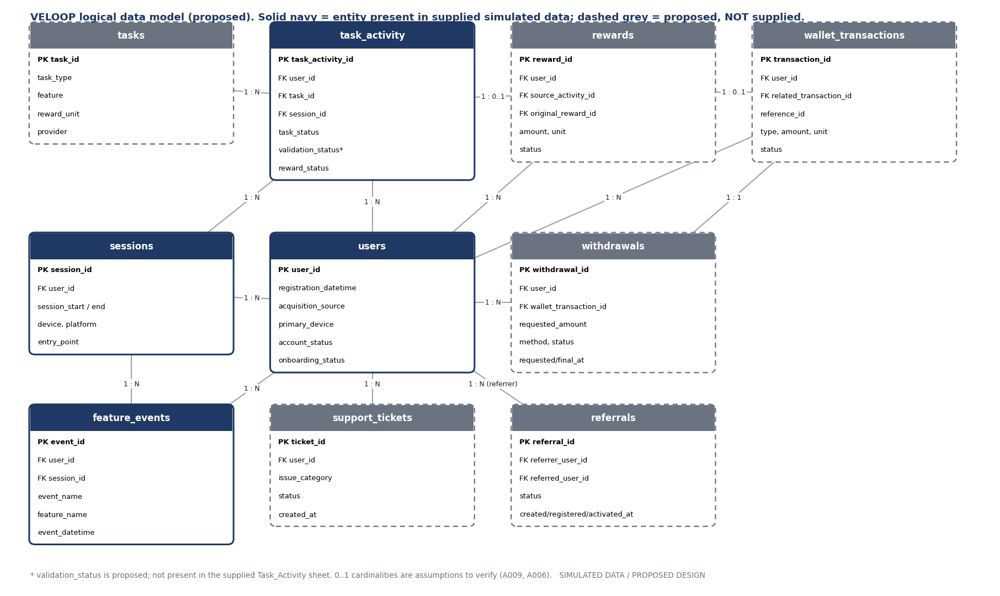
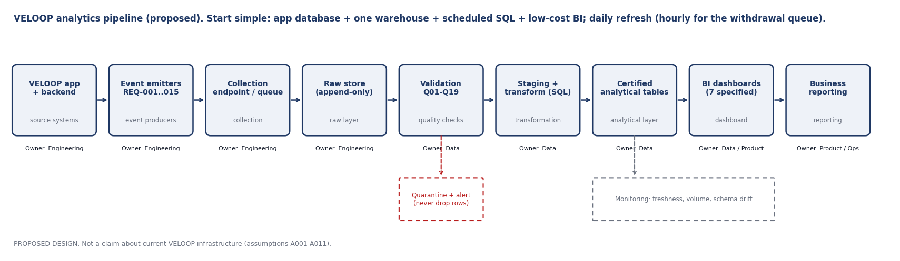

# VELoop-data-analytics-

**VELOOP Rewards: Product Analytics, Data Readiness & Data Management Blueprint** (Data Analyst Internship, Task 01)



*Demo dashboard built only from the supplied simulated data. Not actual VELOOP results.*


> **Data authenticity.** All data in this project is fictional/simulated (*SIMULATED DATA - CREATED FOR ANALYTICAL TESTING*). Nothing here describes actual VELOOP users, earnings, withdrawals, retention or performance. Every proposed event, field and KPI is **Proposed** or **To Be Verified** until engineering confirms it.

## Purpose
Build the structure that lets VELOOP analyse real activity once it exists: what to collect, how to structure it, how to trust it, what to measure, and what engineering must implement. The code profiles and audits the two supplied simulated workbooks and demonstrates cleaning rules.

## Project structure
```
veloop_analytics_project/
  README.md                this file
  requirements.txt         pandas, openpyxl, pytest, matplotlib (+ python-docx, python-pptx for report scripts)
  run.py                   command line entry point
  src/veloop_analytics/    config, loaders, profiling, relationships, quality, kpi_test, cleaning, report, cli
  tests/test_quality.py    11 tests: 6 on the known data-quality counts, 5 unit tests on synthetic data
  scripts/                 make_figures.py, build_report_docx.py, build_presentation.py, design_workbook/ (generator for the design workbook)
  data/raw/                the two supplied simulated workbooks (read-only inputs)
  data/processed/          cleaned CSVs, quarantine file, cleaning summary (generated)
  figures/                 ER diagram, 7 dashboard wireframes, readiness scorecard (generated)
  outputs/                 Analytics_Foundation_Workbook, Data_Profiling_and_DQ_Audit, Readiness_Scorecard (xlsx)
  docs/                    Final report (docx + pdf), 2-page executive summary (pdf), handover presentation (pptx), markdown summary, submission checklist
```

## Dashboard blueprint



## Data model



## Pipeline



## Quick start
```bash
pip install -r requirements.txt python-docx python-pptx
# first copy the two supplied workbooks into data/raw/ (see data/raw/README.md)
python run.py all          # profile + audit + clean  -> outputs/ and data/processed/
python -m pytest -q tests  # 11 tests
python scripts/make_figures.py && python scripts/build_report_docx.py && python scripts/build_presentation.py
```
Runtime on the supplied data is about 15 seconds (largest sheet 35,714 rows). Sheets are read as text so malformed values are never silently coerced; for much larger data, read in chunks or move the checks into SQL.

## Where each required deliverable is
| # | Deliverable | File |
|---|---|---|
| 01 | Executive summary (2 pages) | `docs/VELOOP_Executive_Summary.pdf` |
| 21 | Final consolidated report | `docs/VELOOP_Final_Report.docx` (+ `.pdf`) |
| 02-03 | Product data audit, coverage matrix | `outputs/VELOOP_Analytics_Foundation_Workbook.xlsx` sheets 01-03 |
| 04-07 | User, earning/reward, wallet/withdrawal, referral/engagement specs | report sections 4-7; workbook sheets 04-06, 08 |
| 08, 09 | Event tracking plan, data dictionary (100 fields) | workbook sheets 05, 06 |
| 10 | Logical data model | `figures/er_diagram.png`; workbook sheet 07 |
| 11 | KPI catalogue (46) | workbook sheet 08 |
| 12, 13 | Profiling, data quality audit (34 issues) | `outputs/VELOOP_Data_Profiling_and_DQ_Audit.xlsx` |
| 14 | Dashboard blueprint | workbook sheet 11; `figures/wireframe_*.png` |
| 15 | Developer handoff | workbook sheet 12 |
| 16-17 | Pipeline (diagram `figures/pipeline_architecture.png`), privacy and governance | report sections 15-16; workbook sheet 13 |
| - | Dashboard images | `figures/dashboard_simulated_demo.png` (charts from simulated data, labelled), `figures/dashboard_wireframes_overview.png` (layout only) |
| 18 | Readiness scorecard | `outputs/VELOOP_Readiness_Scorecard.xlsx`; `figures/readiness_scorecard.png` |
| 19-20 | Assumption register, backlog | workbook sheets 16, 17 |
| - | Presentation | `docs/VELOOP_Handover_Presentation.pptx` |

## Main findings (simulated data only)
- The two Users tables share 1,000 user IDs but disagree on every user's attributes: a master must be chosen.
- 0 orphan user/session references; 16 users have no activity.
- No reward amount/unit and no task catalogue; several stored counts do not reconcile.
- 34 issues: 3 Critical, 11 High, 15 Medium, 5 Low.
- Personal fields (name, email, age, gender, city) exist for every user and should be dropped from the analytics layer.

## Limitations and open decisions
- Rewards, Wallet, Withdrawals and Referrals datasets were not supplied; related KPIs are untestable.
- The behaviour workbook is labelled "Task 02"; used as extra simulated data, to be confirmed.
- Engineering verification is needed for all 18 assumptions (workbook sheet 16).
- When production data exists, replace simulated data with governed production data; never mix them.
