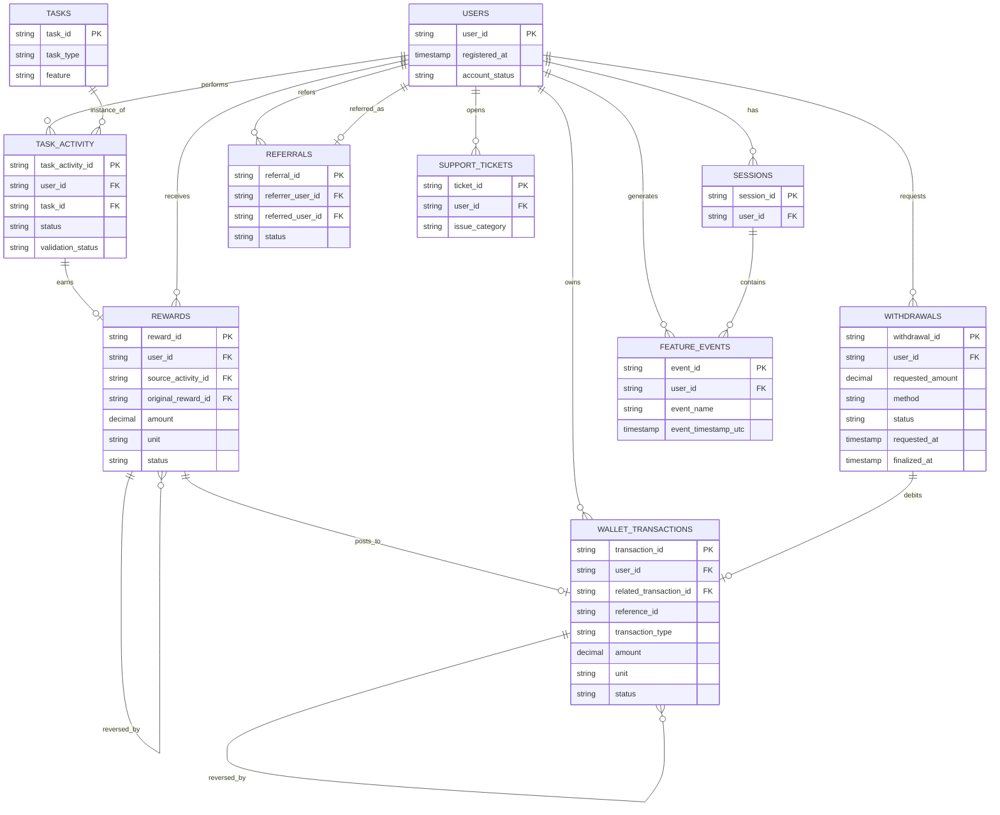
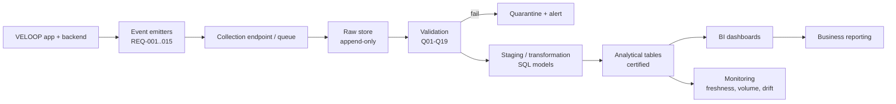

# VELOOP Rewards — Analytics Foundation: Consolidated Report (v0.1)

> **Data authenticity notice.** This report contains no production data. Every event, field, KPI and requirement is **Proposed** or **To Be Verified** unless marked Confirmed. The supplied dataset is simulated (*SIMULATED DATA — CREATED FOR ANALYTICAL TESTING*). Nothing here is an actual VELOOP statistic.

## 1. Executive summary

**Investigated.** The task brief's product scope (accounts, earning tasks, rewards, wallet, withdrawals, referrals, engagement, support) was mapped into a data-readiness audit, an event tracking plan, a data dictionary, a logical model, a KPI catalogue, quality controls, dashboard specs, an engineering handoff, pipeline, governance, change management and a backlog. See `VELOOP_Analytics_Foundation_Workbook.xlsx`.

**Discovered.** The only confirmed facts are those in the brief. No engineering schema, event list or production data was supplied, so every proposed element needs engineering verification (18 items in sheet 16). The biggest structural risks are those the brief hints at: activity vs credited reward, a stable wallet transaction ID, withdrawal state history, referral registration vs conversion, and mixed value units (VE/XP/Gems/Tokens).

**Unknown.** Whether events, session IDs, transaction IDs, reward pending states, withdrawal state history or any feature beyond the supplied data exist in production. The simulated data was received on 28 Oct 2026 and profiled (see §7b); it shows that the supplied pack does **not** contain the Rewards, Wallet, Withdrawals or Referrals tables listed in the brief, so those areas remain design-only.

**What VELOOP should implement (Critical).** Stable `user_id`; immutable `transaction_id` with idempotent wallet writes; defined units and conversion rules; withdrawal state/timestamp history; separate reward record vs activity record; events REQ-001 to REQ-013.

**Risks.** Overstated completion/earning figures if activity is conflated with credit; summing across units; duplicate credits; unreliable daily metrics without a UTC standard; third-party outcomes outside VELOOP control; silent mixing of simulated and production data.

**Priorities.** See backlog (sheet 17): 6 Critical, 7 High, 5 Medium, 2 Low items, with the Prelaunch/Postlaunch stage.

## 2. Product data audit (summary)
Thirty-one feature/area rows are mapped in sheet 02 (user action, system action, business outcome, required data, event, source, question, status, priority). Fifteen analytics gaps (G01–G15) are in sheet 03; four are Critical (user ID, transaction ID, reward-vs-activity, withdrawal history) plus unit definitions (G12).

**Event classes** used throughout: *User Event* (user did something), *System Event* (system recorded an outcome), *Business Outcome* (a derived result such as "converted referral", computed in the analytics layer).

## 3. Event naming standard
`object_action`, lowercase snake_case, past tense: `task_completed`, `withdrawal_rejected`. Rationale: matches the brief's examples; one predictable pattern for engineers; sorts by object; feature is a property, not a name prefix. 38 events are catalogued (sheet 05) with the common envelope: `event_id, event_name, event_timestamp_utc, user_id, schema_version, platform, app_version, session_id?, source_system`.

## 4. Specification summaries
- **User & account (B):** identifiers — `user_id` (join across everything), `event_id` (dedup), `session_id` (session grouping; existence To Be Verified), `transaction_id` (ledger dedup/reconciliation). No names, emails, phone numbers or addresses are required.
- **Earning & rewards (C):** lifecycle Discovery → Start → Completion → Validation → Reward is measured by `task_viewed/opened/started/completed/failed` plus `reward_pending/credited/reversed/corrected`. *Completed* is emitted only after applicable validation; *reward credited* is a separate record linked via `source_activity_id`. Failure categories (`user_abandoned, tracking_failed, validation_failed, provider_error, system_error, unknown`) are **Proposed**, not existing codes. External providers are modelled with `provider` and `provider_ref`; VELOOP does not assume it controls their outcomes.
- **Wallet & withdrawals (D):** ledger with immutable `transaction_id`, `direction`, `reference_id`, `related_transaction_id` for reversals; types `reward_credit, redemption, reversal, adjustment, exchange` are Proposed. Withdrawal: `requested → processing → completed | rejected`, `completed → reversed`; amounts, method category (never account details), three timestamps, reason category. Withdrawal KPIs are K30–K38.
- **Referrals & engagement (E):** `created → registered → activated → converted`; registration never implies conversion. Engagement KPIs K03–K05, K15–K17.

## 5. Logical data model

Cardinalities marked "0..1" (activity→reward, withdrawal→debit entry) are **assumptions to verify** (A009, A006). Full key and relationship tables: sheet 07; 100 dictionary fields: sheet 06 (each is tied to an entity and analytical use; no filler fields).

## 6. KPI catalogue
46 KPIs (sheet 08) across user, engagement, reward, wallet, withdrawal, referral, support/content and data-quality areas, each with definition, formula, required fields, source, frequency, stakeholder, purpose, interpretation, limitation, status. **No targets are set.** Example: *DAU = unique users generating a qualifying activity event within a UTC calendar day* (qualifying list To Be Verified, A017).

**KPI testability (J3), tested on the simulated data:** user, session, engagement and task KPIs (K01–K05, K07, K09–K12, K15–K17, K24 as a count) can be calculated. Onboarding (K06) and failure analysis (K14) are only partial. Reward-amount, wallet, withdrawal, referral-funnel and support KPIs (K18–K20, K23, K25–K45) **cannot** be calculated; the required data is named in sheet J3_KPI_Test of `VELOOP_Data_Profiling_and_DQ_Audit.xlsx`.

## 7. Data quality
- **Audit (K):** 34 issues with counts, severity, detection logic, cause, correction, prevention and owner are in `VELOOP_Data_Profiling_and_DQ_Audit.xlsx`, sheet K_DQ_Report. Sheet 09 in the design workbook is the generic check catalogue.
- **Controls (L):** 20 rules (sheet 10), each placed in a pipeline layer: ID/amount/timestamp/enum validation at application and ingestion; duplicate detection at ingestion by `event_id`/`transaction_id`; referential integrity and state-transition checks in transformation; reward↔wallet reconciliation in the analytics layer; certified-source gating at the dashboard.

## 7b. Simulated data profiling and findings (Work Packages J and K)
*All statements below describe the supplied simulated datasets only ("In the provided simulated dataset…"), never actual VELOOP behaviour.*

**Files received.** (A) `VELoop_Rewards_Data_01.xlsx`: Users_1000_Clean (1,000 rows, 27 columns), Users_Messy_Audit (1,008 rows), dictionary and summary. (B) `VELOOP_Simulated_User_Behavior_1000.xlsx`, which labels itself "Task 02": Users (1,000), Sessions (7,913), Feature Events (35,704), Daily Activity (6,667), Task Activity (9,846), Milestones (4,799), Feature Usage (15), and an events audit sheet (35,714 rows). Period stated: 1 Apr – 15 Sep 2026. **Not supplied:** Rewards, Wallet, Withdrawals, Referrals tables.

**Profile highlights.** Dates fall within the stated period except 4 last-login values (up to 17 Sep) in Users_Clean. All sessions, events, tasks, daily rows and milestones link to a valid user (0 orphans); events, tasks and milestones link to valid sessions; 16 users have no sessions, events or tasks. `platform` is "Web" for every row. Task Activity statuses: Completed 5,627, Abandoned 2,051, Failed 1,520, Pending 648; Credited = Completed in every row. The Feature Usage sheet reconciles exactly to Feature Events.

**Most important findings (by severity).**
1. **Critical, cross-file conflict:** both files use the same 1,000 user_ids (VLUSR000001–1000) but describe different people: names, emails and registration times differ for all 1,000, state for 945, city for 977, account status for 571. The two Users tables must not be mixed; one must be declared the user master (decision needed, assumption A016).
2. **Critical, Messy_Audit:** 8 duplicate user rows, 9 injected nulls in required fields (including a missing registration time), 1 malformed date (`2026-14-02 12:00`), 2 registration times that conflict with the clean baseline.
3. **High, structure:** no reward amount/unit, no task catalogue (all 80 task_ids map to several categories), 423 daily rows with completed tasks > tasks, `events_in_session` wrong for 7,537 of 7,913 sessions, 302 sessions without events, 2 shared referral codes, and 10 duplicate events plus 4 trailing-space statuses and 5 inconsistent feature names in the event audit sheet.
4. **High, governance:** full name, email, age, gender and city are present for every user, contrary to the "no unnecessary personal data" rule; they should be excluded from the analytics layer.
5. **Dictionary gaps:** `platform` and `country` missing from dictionary A; dictionary B lists 26 fields for 6 sheets.

**What this means for the design.** The proposed tables for rewards, wallet, withdrawals and referrals are untested; the Task Activity table is the closest proxy for reward activity. Backlog items on unit definitions, ledger IDs, reward-activity separation and a user master become higher confidence.

## 8. Dashboard blueprint
Seven dashboards, 28 visuals (sheet 11), each with metric, calculation, source, visualization, filters, dimensions, date range, refresh, business question and decision supported. Wireframes for all seven dashboards are in `figures/` and the Word report; they show layout only, no values.

## 9. Developer handoff
Fifteen requirements REQ-001–015 (sheet 12) with trigger, payload (type/required/validation), deduplication, timestamp, source, KPI dependency, acceptance test and priority. Acceptance tests are written subject to engineering's final idempotency design.

## 10. Pipeline (practical, scalable when justified)

Start with the application database plus a single managed warehouse or even a relational database with scheduled SQL transformations and a free/low-cost BI tool; move to streaming or heavier tooling only when event volume or latency needs justify it. Refresh: daily batch initially; hourly only for the withdrawal queue. Failure handling: failed loads retried, bad rows quarantined (never dropped), owners alerted. Ownership: Engineering = emitters and raw; Data = validation, transformation, KPI definitions, dashboards; Product/Ops = definitions of qualifying activity and states.

## 11. Governance, privacy and change management
Access model in sheet 13. Never collected or stored in analytics: passwords, authentication secrets, API keys, payment credentials, bank/card numbers, security-control details, fraud thresholds. Payout `provider_ref` is Restricted. Country is coarse only; privacy review recorded as A018.

**Change management:** any change to an event, field, reward mechanic, withdrawal method, KPI or dashboard is logged (sheet 14 template: date, change, old/new definition, reason, affected KPIs/dashboards/reports, owner, version). Rules: semantic version on every event schema; renamed events keep an alias for a declared period; KPI definition changes create a new KPI version and are annotated on dashboards; new features must pass an analytics checklist (events, dictionary entries, KPIs, DQ rules) before launch.

## 12. Gap assessment and backlog
Sheet 15 scores ten dimensions with reasons; sheet 17 holds the 20-item prioritised backlog. Unknowns: sheet 16 (A001–A018).

## 13. Deliverable index
| # | Deliverable | Where |
|---|---|---|
| 01 | Executive summary | §1 |
| 02 | Product data audit | §2, sheets 01–03 |
| 03 | Data coverage matrix | sheet 02 |
| 04 | User analytics spec | sheet 04 |
| 05–07 | Earning/reward, wallet/withdrawal, referral/engagement | §4, sheets 05, 06, 08 |
| 08 | Event tracking plan | sheet 05 |
| 09 | Data dictionary | sheet 06 |
| 10 | Logical data model | §5, sheet 07 |
| 11 | KPI catalogue | sheet 08 |
| 12 | Simulated data profiling | §7b, `VELOOP_Data_Profiling_and_DQ_Audit.xlsx` (J1–J3) |
| 13 | Data quality audit | §7b, sheet K_DQ_Report (34 issues); controls sheet 10 |
| 14 | Dashboard blueprint | sheet 11 and `figures/wireframe_*.png` |
| 15 | Developer handoff | sheet 12 |
| 16 | Pipeline proposal | §10; `figures/pipeline_architecture.png` |
| 17 | Privacy and governance | §11, sheet 13 |
| 18 | Readiness assessment | sheet 15 (qualitative scorecard; no numeric score invented) |
| 19 | Assumption register | sheet 16 |
| 20 | Backlog | sheet 17 |
| 21 | This report | — |

## 14. Known limitations of this submission
1. Rewards, Wallet, Withdrawals and Referrals datasets were not in the supplied files; related KPIs and tables are design-only.
2. Dataset B calls itself "Task 02"; it was used as additional simulated data because it overlaps the Task 01 scope. Please confirm this is intended.
3. The Mermaid diagrams in this file are text; rendered versions are in `figures/` and the Word report.
4. No Source & Verification entry can be marked Confirmed beyond the brief itself and the supplied files' own READMEs.
5. This markdown file is a summary; the final report is `VELOOP_Final_Report.docx` (and PDF).
